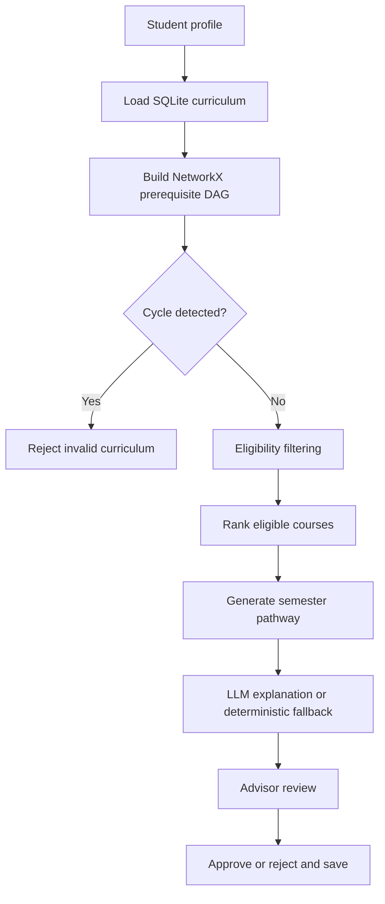

# Algorithm Details

The service uses deterministic rules for eligibility, ranking, and pathway decisions. Claude can only explain the structured result; it cannot approve or change eligibility.

## A. Prerequisite DAG construction

**Objective:** Represent prerequisite relationships and reject invalid cyclic curricula.

**Input:** Course codes and prerequisite pairs from SQLite. **Output:** A directed NetworkX graph with edges `prerequisite → dependent course`, plus a topological order.

**Steps:** Add each catalog course as a node; add every prerequisite edge; use `is_directed_acyclic_graph`; reject a cycle; use `topological_sort` for a valid ordering. Immediate predecessors are direct requirements and descendants are courses unlocked downstream.

```text
BUILD_GRAPH(courses, prerequisite_pairs):
  G ← directed graph
  add every course code as a node in G
  for (required, dependent) in prerequisite_pairs:
    add edge required → dependent
  if G is not a DAG: raise invalid-curriculum error
  return G, topological_sort(G)
```

**Complexity:** `O(V + E)` time and space for `V` courses and `E` prerequisite links. **Example:** `CS101 → CS201 → CS301` means completing CS101 alone does not satisfy the direct prerequisite CS201 for CS301.

## B. Eligibility filtering

**Objective:** Include only uncompleted courses whose prerequisites, offering status, course horizon, and individual credit feasibility pass.

**Input:** Profile `S`, catalog `C`, prerequisite DAG `G`. **Output:** Eligible courses and blocked courses with explicit reasons.

**Steps:** Skip completed course codes; collect every upstream prerequisite with `networkx.ancestors`; compare them against completed courses; reject if any are missing; reject unavailable courses, courses beyond the near-term planning horizon, or courses whose individual credit count exceeds the profile's cap; return pass/fail records. Checking the full ancestor set prevents inconsistent imported histories from bypassing a prerequisite chain. The semester credit cap is also enforced across each generated term.

```text
FILTER(S, C, G):
  for course c in C:
    if c.code in S.completed: continue
    required ← all ancestors of c.code in G
    missing ← required - S.completed
    reasons ← missing prerequisites, unavailable, too-far-ahead, or exceeds credit cap
    if reasons empty: eligible.add(c)
    else: ineligible.add(c, reasons)
  return eligible, ineligible
```

**Complexity:** `O(V + E)` per course for the ancestor lookup, or `O(V(V + E))` for a full catalog evaluation; `O(V + E)` graph storage. **Example:** Machine Learning requires Python, Linear Algebra, and Probability; if Probability is absent, the course is blocked and the missing code is shown.

## C. Course ranking

**Objective:** Order eligible courses transparently against student goals.

**Input:** Eligible course and profile fields. **Output:** A stable score, rank, factor values, and reason. Weights are defined in `backend/app/services/advising.py`.

```text
score = 100 × (0.35×interest_match + 0.25×career_relevance
             + 0.20×academic_fit + 0.10×prerequisite_progress
             + 0.10×semester_fit)
```

Interest match is the share of course interest tags present in the student's interests. Career relevance uses the goal and course tags. Academic fit scales GPA to 0–1 and reduces fit for difficulty above 3. Prerequisite progression gives a modest preference to courses that unlock successors. Semester fit favors courses within the next curriculum term. The five weights can be configured with the `ADVISOR_WEIGHTS` JSON environment variable; the service validates the keys and non-negative values, then normalizes them to sum to 1. Sort by descending score, then semester and course code for deterministic ties.

**Complexity:** `O(K log K + T)` time for `K` eligible courses and `T` total tag comparisons; `O(K)` output space. **Example:** A course matching AI and NLP interests with completed prerequisites can outrank a general elective; blocked courses never enter scoring.

## D. Semester pathway generation

**Objective:** Build a feasible multi-term progression that respects prerequisite order and a per-term credit ceiling.

**Input:** Student profile, DAG, eligible-course scores. **Output:** Up to four semester entries containing selected courses and total credits.

**Steps:** Start the first term at the student's current semester. At each term, select courses whose predecessors are all completed or scheduled in an earlier term, that are available and within the curriculum horizon. Sort by recommendation score and stable tie-breakers. Greedily add courses while the credit cap permits. Mark selected courses completed for subsequent iterations. Stop after the horizon or when no courses remain.

```text
PLAN(S, G, horizon=4):
  done ← S.completed; remaining ← nodes(G) - done
  for term from S.semester to S.semester+horizon-1:
    ready ← remaining whose prerequisites are all in done
    sort ready by score descending, then semester and code
    selected ← greedily add while term credits ≤ S.max_credits
    append term if selected is nonempty
    done ← done ∪ selected; remaining ← remaining - selected
  return terms
```

**Complexity:** `O(H × (V(V + E) + V log V))` time for horizon `H`, including ancestor checks; `O(V + E)` space. The greedy planner is practical for the small pilot curriculum but does not guarantee a globally optimal graduation plan; degree audits, section seats, and alternate terms remain future work.

## Overall flowchart


