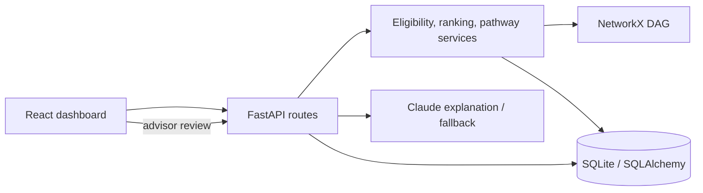

# Architecture and Review 3 Draft Report

## Project overview

The AI-Enabled Student Advising Assistant for Course Pathway Planning helps a student explore prerequisite-safe courses and helps an advisor review a suggested multi-semester plan. The pilot demo uses an illustrative AI/CS curriculum and seeded sample student. It is not an official university degree audit.

## Problem and objectives

Manual planning requires advisors to reconcile student history, interests, goals, prerequisites, and credit limits. This MVP models the curriculum as a DAG, filters courses using hard constraints, ranks eligible courses with a transparent weighted score, creates a short pathway, explains results, and stores an advisor decision.

## System design

React/Vite/Tailwind provides the dashboard. FastAPI exposes JSON endpoints and Pydantic validates profile and review inputs. SQLAlchemy maps SQLite tables. NetworkX validates and traverses course prerequisite links. The Claude API is optional and receives computed advising facts; a local deterministic explanation works without credentials.

## Implemented modules

1. Student profile view/edit with completed courses, credits, interests, career target, GPA, semester and credit limit.
2. Course catalog and prerequisite edges seeded for 15 Computer Science / AI courses.
3. Graph construction, DAG validation and prerequisite queries.
4. Eligibility and reasons, recommendation scores/factors, and bounded four-term pathway.
5. AI advisor explanation with offline fallback.
6. Advisor review queue with approval/rejection and saved note.

## Evaluation and limitations

Algorithm and API behavior has ten passing pytest cases covering prerequisites, completed-course filtering, credit constraints, ranking repeatability and configuration, pathway prerequisite order, cycle detection, course/prerequisite lookup, and advisor approval. The curriculum and profile are demo data. Current term availability is a simple boolean; sections, seats, degree requirements, authentication, advisor audit history, and official transcript import are not implemented. The planner is greedy and plans a four-term window, not a guaranteed graduation audit. GPA uses a 4-point scale in this seed data.

## Review 3 demo procedure (5–10 minutes)

1. Start backend and frontend using the README commands; open `http://localhost:5173`.
2. Show the seeded student and overview counts.
3. Open Student Profile and point out semester, GPA, interests, completed-course codes, and credit maximum. Save only if you made a change.
4. Open Eligibility. Show eligible AI courses and blocked Deep Learning / Generative AI reasons.
5. Explain the weighted score and why eligible courses are ranked. Mention hard prerequisite filters run before scores.
6. Open Prerequisite Graph and trace Python → Machine Learning → Deep Learning.
7. Generate a semester pathway and show prerequisites before dependent courses and term credits within the cap.
8. Ask “Why is Machine Learning recommended?” in AI Advisor. The demo still answers when Claude is unconfigured.
9. Open Advisor Review, add a note, and approve the plan. The status is stored in SQLite.

## Viva notes

**Why a DAG?** Course prerequisites are directional dependencies; DAG structure enables cycle checks and topological ordering.

**Can the LLM decide eligibility?** No. Backend graph logic decides it; the LLM only verbalizes supplied structured results.

**How does the planner respect prerequisites?** A course is ready only when every upstream prerequisite in the DAG is in the completed set. Earlier planned courses are added to that set at the next semester.

**How is the score explainable?** It is a weighted sum of five bounded factors, returned with its factor values and configured weights.

**What if Claude is offline?** A deterministic fallback explanation uses the same computed rank and course data.

**What are current limitations?** Sample curriculum, greedy four-term horizon, no seat/section availability model, no authentication, and no official graduation audit.

## Possible viva questions

| Question | Short answer |
|---|---|
| How is a prerequisite cycle detected? | NetworkX `is_directed_acyclic_graph` checks the course dependency graph before planning. |
| What prevents unsafe recommendations? | Eligibility is a deterministic precondition; blocked courses do not enter the ranking list. |
| Why use SQLite? | It is simple to run locally for a review demo and SQLAlchemy keeps persistence portable. |
| How do you add a course? | Add a catalog row and prerequisite rows through seed/database tooling, then validate the DAG. |
| Is the pathway globally optimal? | No; the pilot uses a score-ordered greedy planner with a credit cap and prerequisite order. |
| Where does human oversight occur? | In the advisor queue, where a saved plan can be approved or rejected with a note. |
