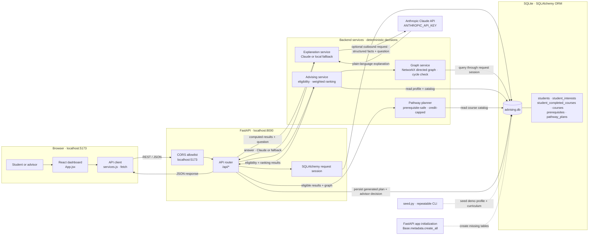

# Runtime Architecture

This diagram describes the application that runs locally. The browser uses the Vite-served React application, which calls the FastAPI backend over REST/JSON. The backend performs eligibility, ranking, pathway, and advisor decisions; Claude is an optional explanation service only.

## Runtime flow

1. Vite serves the React dashboard. Its API client sends requests to `http://localhost:8000/api`.
2. FastAPI routes obtain a SQLAlchemy session. Student and curriculum data are read from SQLite.
3. The graph service builds prerequisite → dependent-course edges and rejects cyclic curriculum data.
4. Eligibility filters out completed courses, incomplete prerequisite chains, unavailable or too-far-ahead courses, and courses individually larger than the student's credit cap. Eligible courses are ranked with the backend's five-factor weighted score.
5. The pathway planner schedules courses only after all upstream prerequisites are completed or scheduled in an earlier term, while respecting each term's combined credit limit. The generated plan is persisted as `pending`.
6. For chat, deterministic advising results are computed before the explanation service runs. If Claude is configured, it receives those results and the question; otherwise the local fallback answers from the same structured results.
7. The advisor queue reads saved plans. Approval or rejection updates the plan status and advisor note in SQLite.

## Runtime boundaries

- The frontend renders and collects input; it does not determine eligibility, rankings, or pathway order.
- Prerequisite safety and pathway constraints are deterministic backend logic. Claude cannot change those decisions.
- The current runtime is local development: Vite on port 5173, FastAPI on port 8000, and a SQLite file resolved relative to the backend process working directory.
- `DATABASE_URL` can override the SQLite URL. `ANTHROPIC_API_KEY` enables Claude explanations; absence of the key leaves the core advising flow operational.
